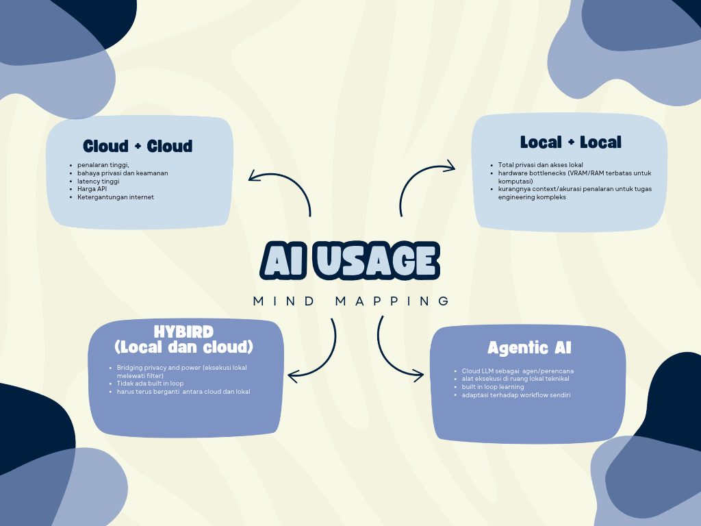

# pembuatan ai personal lokal menggunakan agentic ai cloud untuk technical engineering dengan built in loop learning



## Latar Belakang:

Interaksi manusia dengan komputer telah bergeser dari sekadar *command-line interface* (CLI), antarmuka grafis (GUI), hingga kini memasuki era di mana AI bertindak sebagai kolaborator aktif. Dulu, teknologi hanya merespons apa yang kita ketik atau klik secara kaku. Kini, dengan hadirnya *Large Language Models* (LLM), interaksi berubah menjadi percakapan alami yang dinamis. 

Namun, transisi ini menciptakan dilema baru: bagaimana manusia di bidang teknikal (*engineering*) bisa berinteraksi dengan AI yang cerdas tanpa harus mengorbankan uang yang banyak, kepemilikan infrastruktur, atau terhalang keterbatasan perangkat keras (*hardware*).

---

## Mengapa Pembahasan Ini Bisa Berinteraksi Dengan masalah Tersebut?

Secara umum, adopsi AI sering kali terjebak dalam dikotomi yang salah: memilih antara **kenyamanan instan berbasis cloud** atau **keamanan absolut secara lokal**. Padahal, untuk kebutuhan nyata di dunia *technical engineering*, kedua pendekatan standar tersebut memiliki celah yang besar:
* Mengandalkan **Cloud sepenuhnya** tidak aman untuk data kepemilikan dan pemakaian dana yang banyak untuk API.
* Mengandalkan **Local sepenuhnya** sering kali gagal memberikan penalaran yang cukup mendalam karena keterbatasan perangkat.

Oleh karena itu, pembahasan ini sangat penting karena ia membantu jurang masalah tersebut. Melalui pendekatan **Agentic AI dengan *built-in loop learning***, kita tidak lagi melihat AI sekadar sebagai "mesin tanya-jawab" pasif, melainkan sebagai sistem otonom yang bisa merencanakan, mengeksekusi di ruang lokal secara aman, dan belajar secara terus-menerus dari *workflow* kita sendiri.

---

## Ringkasan Tugas & Evaluasi Masalah

Proyek ini berfokus pada pengembangan AI personal yang adaptif untuk kebutuhan teknikal melalui 4 tahapan evaluasi masalah:

### 1. Cloud + Cloud (Full Cloud)
* **Karakteristik:** Mengandalkan model dan infrastruktur *cloud* sepenuhnya.
* **Analisis Masalah:** Menawarkan penalaran tinggi, namun memiliki kelemahan fatal pada risiko privasi/keamanan data, latensi tinggi, biaya API yang mahal, dan ketergantungan pada koneksi internet.

### 2. Local + Local (Full Local)
* **Karakteristik:** Menjalankan model dan komputasi sepenuhnya di perangkat lokal.
* **Analisis Masalah:** Memberikan privasi dan akses lokal penuh, namun bermasalah pada *hardware bottlenecks* (keterbatasan VRAM/RAM dan storage) serta akurasi penalaran yang kurang untuk tugas *engineering* yang lumayan kompleks.

### 3. Hybrid (Kombinasi Local & Cloud)
* **Karakteristik:** Berusaha memadukan eksekusi lokal dan *cloud*.
* **Analisis Masalah:** Masalah seperti tidak konsisten, tidak ada-nya *built-in loop* yang otomatis, sehingga pengguna harus terus-menerus berganti (*switching*) secara manual antara *cloud* dan *local*.

### 4. Agentic AI (Cloud LLM Technique)
* **Karakteristik:** Solusi puncak yang menggunakan *Cloud LLM* sebagai agen perencana/otak utama, dikombinasikan dengan alat eksekusi di ruang lokal teknikal.
* **Keunggulan:** Dilengkapi **built-in loop learning** yang memungkinkan sistem melakukan iterasi, evaluasi mandiri, dan adaptasi secara *real-time* terhadap *workflow* kerja pengguna.

---

## Implementasi Struktur Data (`code-visual.cpp`)

Berikut adalah representasi kode C++ untuk memvalidasi parameter sistem (*Internet, Privacy, Hardware, RAM, Storage, API Budget*, dll.) yang digunakan dalam perancangan logika AI lokal:

```cpp
#include <iostream>
#include <string>

using namespace std;

struct info {
    bool internet;
    bool privacy;
    bool hardwareinfo;
    bool hasvga;
    int taskcomplexlevel;
    int localramsize;
    int localvgasize;
    int storagecap;
    int apibudget;
};

void validation(info i) {

    

    cout << "Internet: " << (i.internet ? "Yes" : "No") << endl;
    cout << "Privacy: " << (i.privacy ? "Yes" : "No") << endl;
    cout << "Hardware Info: " << (i.hardwareinfo ? "Yes" : "No") << endl;
    cout << "Has VGA: " << (i.hasvga ? "Yes" : "No") << endl;
    cout << "Task Complexity Level: " << i.taskcomplexlevel << endl;
    cout << "Local RAM Size: " << i.localramsize << endl;
    cout << "Local VGA Size: " << i.localvgasize << endl;
    cout << "Storage Capacity: " << i.storagecap << endl;
    cout << "API Budget: " << i.apibudget << endl;
}

int main() {
    return 0;
}
```